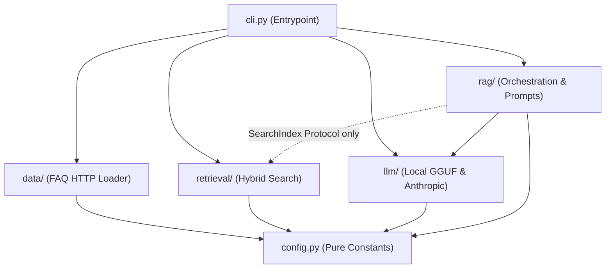

# llm-rag-faq

Hybrid lexical + semantic Retrieval-Augmented Generation (RAG) assistant for DataTalks.Club course FAQs, supporting both in-process local GGUF inference (`llama-cpp-python` / `Qwen2.5-1.5B-Instruct-GGUF`) and Anthropic Claude (`claude-haiku-5-5`) behind a unified `LLMClient` protocol.

Built as a layered, modular Python package (`src/` layout) with strict one-way dependency boundaries enforced by both zero-dependency AST tests and `import-linter`, full offline unit test coverage, prompt-injection hardening, and SHA-256 disk caching.

---

## Key Features

- **Hybrid Retrieval + 1-Based RRF**: Combines `minsearch` TF-IDF lexical search (`DEFAULT_BOOST = {"question": 3.0, "section": 0.5}`) with `fastembed` (`BAAI/bge-small-en-v1.5`) L2-normalized semantic search via 1-based Reciprocal Rank Fusion (`DEFAULT_RRF_K = 60`).
- **Local Offline GGUF & Cloud Anthropic Parity**: `LocalGGUFClient` and `AnthropicClient` both implement the `@runtime_checkable` `LLMClient` protocol (`generate(system, prompt, max_tokens) -> str`), while `RAGBase` also preserves compatibility with raw `anthropic.Anthropic` clients.
- **Agentic Query-Rewrite Fallback**: When initial retrieval returns no documents or the LLM replies with a standalone refusal (`"I don't know."`), `RAGBase.rewrite_query()` issues a short keyword rewrite (`REWRITE_INSTRUCTIONS`, `max_tokens=64`) and retries once only if `_doc_fingerprint()` detects genuinely new passages.
- **Security & Resource Lifecycle**:
  - Pinned Hugging Face model artifact (`Qwen/Qwen2.5-1.5B-Instruct-GGUF`, `qwen2.5-1.5b-instruct-q4_k_m.gguf`, commit SHA `91cad51170dc346986eccefdc2dd33a9da36ead9`) with wildcard rejection and `local_files_only` support.
  - XML-delimited `<context>` / `<question>` prompts with closing-tag escaping (`escape_delimiter_tags`), ChatML control-token sanitization (`_sanitize_control_tokens`), token budgeting against `n_ctx=4096`, and path-traversal validation (`_validate_course_slug`).
  - Content-hashed `.npy` embedding caches loaded with `allow_pickle=False`, plus `close()` and `with` context managers to release native `llama.cpp` memory cleanly.
- **Enforced Layered Architecture**: Strict acyclic dependency matrix checked offline by `tests/test_architecture.py` (stdlib `ast`) and in CI by `import-linter`.

---

## Architecture & Repository Layout

### Layered Dependency Rules (Option B)



| Layer | Allowed Internal Imports | Forbidden / Isolated |
|---|---|---|
| `config` | *(none)* | Any `llm_rag_faq.*` module |
| `data` | `config` | `retrieval`, `llm`, `rag`, `cli`, `__init__` |
| `retrieval` | `config` | `data`, `llm`, `rag`, `cli`, `__init__` |
| `llm` | `config` | `data`, `retrieval`, `rag`, `cli`, `__init__` |
| `rag` | `config`, `llm` | `data`, `cli`, `__init__`, and raw SDKs (`requests`, `minsearch`, `fastembed`, `llama_cpp`, `anthropic`, `huggingface_hub`) |
| `cli` | `config`, `data`, `retrieval`, `llm`, `rag` | `__init__` (avoids facade cycle) |
| `__init__` | `data`, `retrieval`, `llm`, `rag` | Exposes the 7-symbol public facade |

### Repository Tree

```text
llm-rag-faq/
├── .env.example                    # ANTHROPIC_API_KEY=, HF_TOKEN= (no secrets)
├── .gitignore
├── .python-version                 # 3.12
├── Makefile                        # lint, format, typecheck, arch, test, check
├── README.md
├── pyproject.toml                  # PEP 621 config, ruff, mypy, pytest, import-linter
├── uv.lock
├── .github/workflows/ci.yml        # GitHub Actions CI running `make check`
├── docs/
│   ├── code-review-notes.md
│   ├── notebook-usage-guide.md
│   └── system-architecture.md
├── notebooks/
│   ├── 01_rag_exploration.ipynb    # Initial exploratory RAG notebook
│   └── 02_hybrid_rag_demo.ipynb    # End-to-end hybrid RAG demo via llm_rag_faq facade
├── src/llm_rag_faq/
│   ├── __init__.py                 # 7-symbol public facade (__all__)
│   ├── config.py                   # Centralized constants and defaults
│   ├── cli.py                      # One-shot & interactive REPL CLI
│   ├── data/
│   │   ├── __init__.py
│   │   └── faq_loader.py           # DataTalks.Club HTTP fetching & JSON disk cache
│   ├── retrieval/
│   │   ├── __init__.py
│   │   └── hybrid.py               # HybridFAQSearch, Embedder, build_index, RRF, .npy cache
│   ├── llm/
│   │   ├── __init__.py
│   │   ├── base.py                 # LLMClient Protocol
│   │   ├── local_gguf.py           # LocalGGUFClient (llama-cpp-python)
│   │   └── anthropic_client.py     # AnthropicClient + extract_anthropic_text
│   └── rag/
│       ├── __init__.py
│       ├── prompts.py              # INSTRUCTIONS, REWRITE_INSTRUCTIONS, escaping & rendering
│       └── pipeline.py             # SearchIndex Protocol, RAGBase, RAGResult
└── tests/
    ├── __init__.py
    ├── conftest.py                 # Offline test doubles (FakeEmbedder, FakeLlama, FakeAnthropic)
    ├── test_architecture.py        # Zero-dependency AST cycle/layer/SDK/facade checks
    ├── data/test_faq_loader.py
    ├── retrieval/test_hybrid.py
    ├── llm/test_local_gguf.py
    └── rag/test_pipeline.py
```

---

## Quickstart

### 1. Prerequisites & Installation

- Python `3.12` (`>=3.11,<3.14` supported in `pyproject.toml`)
- [`uv`](https://docs.astral.sh/uv/)

```bash
# Runtime dependencies
uv sync

# Runtime + dev/CI tooling (pytest, ruff, mypy, import-linter)
uv sync --group dev
```

> **Note:** If you modify `pyproject.toml` dependencies, run `uv lock` in an online environment to refresh `uv.lock` before running `uv sync --locked --group dev` in CI.

### 2. Environment Configuration

```bash
cp .env.example .env
```

| Variable | Required | Purpose |
|---|---|---|
| `ANTHROPIC_API_KEY` | Optional | Enables Anthropic Claude (`--provider anthropic` or `--provider auto` when set). If omitted, `--provider auto` falls back to `LocalGGUFClient`. |
| `HF_TOKEN` | Optional | Higher Hugging Face Hub rate limits when downloading embeddings or the GGUF model. |

### 3. CLI Usage (`uv run llm-rag-faq`)

Run a one-shot query or omit the query argument to launch an interactive REPL (`quit`, `exit`, or `:q` to exit):

```bash
# One-shot query with retrieved sources
uv run llm-rag-faq "Can I join late?" --show-sources

# Interactive REPL for a specific course
uv run llm-rag-faq --course llm-zoomcamp

# Force local GGUF backend across all courses
uv run llm-rag-faq --provider local --course all "How do certificates work?"
```

| Flag | Default | Description |
|---|---|---|
| `query` | `None` | Positional question; omit to start an interactive REPL. |
| `--course` | `"llm-zoomcamp"` | Course slug to filter (`all` searches across all courses). |
| `--provider` | `"auto"` | Backend selector: `auto`, `local`, or `anthropic`. |
| `--model` | `"claude-haiku-5-5"` | Anthropic model ID. |
| `--model-path` | `None` | Path to a local `.gguf` file (implies local backend under `auto`). |
| `--cache-dir` | `".cache"` | Directory for cached FAQ JSON and `.npy` embeddings. |
| `--num-results` | `3` (local) / `5` (cloud) | Number of FAQ passages to retrieve. |
| `--show-sources` | `False` | Print retrieved FAQ metadata beneath the answer. |
| `--no-fallback` | `False` | Disable the single-retry query-rewrite fallback. |
| `--local-files-only` | `False` | Disallow network downloads when resolving the local GGUF model. |

### 4. Python Public Facade

The package root exports seven public symbols in `llm_rag_faq.__all__`: `AnthropicClient`, `HybridFAQSearch`, `LocalGGUFClient`, `RAGBase`, `RAGResult`, `build_index`, and `load_faq_data`.

```python
from llm_rag_faq import AnthropicClient, LocalGGUFClient, RAGBase, build_index, load_faq_data

docs = load_faq_data(course="llm-zoomcamp", cache_dir=".cache")
index = build_index(docs, cache_dir=".cache")

with RAGBase(index=index, llm_client=None, course="llm-zoomcamp") as assistant:
    result = assistant.rag_with_sources("Where do I ask live workshop questions?")
    print(result.answer)
```

### 5. Jupyter Notebooks

- [notebooks/01_rag_exploration.ipynb](notebooks/01_rag_exploration.ipynb) — Initial exploratory RAG notebook using `requests`, `minsearch`, and Anthropic.
- [notebooks/02_hybrid_rag_demo.ipynb](notebooks/02_hybrid_rag_demo.ipynb) — End-to-end hybrid RAG demo importing from the `llm_rag_faq` facade and sharing the repo-root cache via `CACHE_DIR = "../.cache"`.

---

## Testing, Architecture Checks & CI

### Offline Verification (Zero Dev Dependencies Required)

All 100 unit and AST architecture tests run completely offline with stdlib `unittest` inside the runtime virtual environment:

```bash
# Run all 100 unit + architecture tests
python -m unittest discover -s tests -v

# Run architecture boundary, cycle, SDK isolation, and facade tests only
python -m unittest tests/test_architecture.py -v
```

### Full Quality Suite (`make check`)

Once dev dependencies are installed (`uv sync --group dev`), run the full check pipeline defined in [Makefile](Makefile):

```bash
make check
```

`make check` runs:
1. `make lint` — `uv run ruff check src tests` and `uv run ruff format --check src tests`
2. `make typecheck` — `uv run mypy src`
3. `make arch` — `uv run lint-imports` and `uv run pytest tests/test_architecture.py -v`
4. `make test` — `uv run pytest -v`

GitHub Actions ([.github/workflows/ci.yml](.github/workflows/ci.yml)) executes `uv sync --locked --group dev` followed by `make check` on every `push` to `main` and every `pull_request`.

---

## Documentation

- [System Architecture](docs/system-architecture.md) — Layered Option B design, hybrid retrieval & 1.5B local LLM strategies, protocols, and enforcement checks.
- [Python Standards & Patterns](docs/python-standards-and-patterns.md) — Beginner-friendly guide to the Python conventions, imports/exports, privacy, attributes, decorators, protocols, constraints, and testing patterns used in this repository.
- [Jupyter Notebook Usage Guide](docs/notebook-usage-guide.md) — Cell-by-cell guide for running the notebooks with shared `../.cache`, streaming, and OOM prevention.
- [Code Review & Security Notes](docs/code-review-notes.md) — Before/after catalog of bugs, prompt-injection hardening, supply-chain pinning, and boundary rules.
