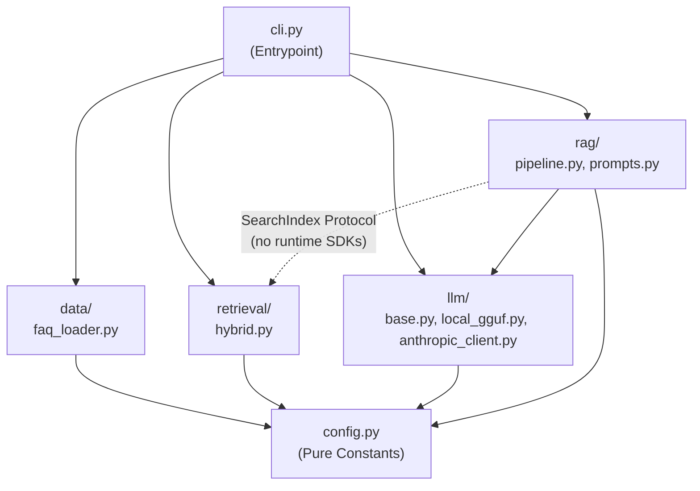
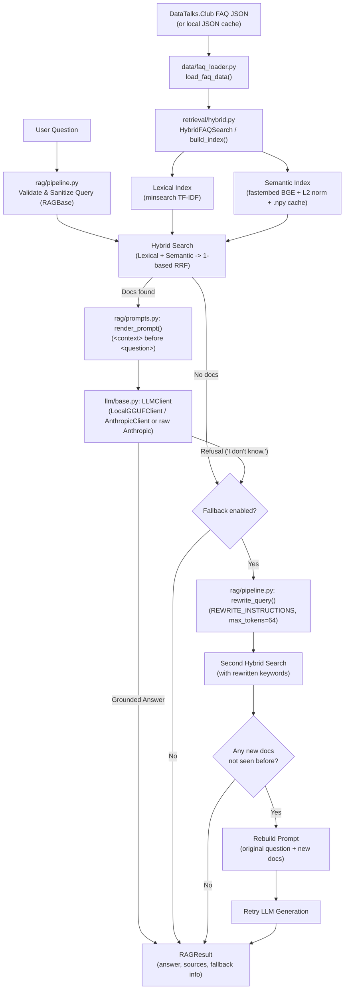

# System Architecture & How `llm-rag-faq` Works with a Limited Local LLM

This document explains the layered architecture of `llm-rag-faq`, how the pipeline works end-to-end, how module boundaries are enforced, and **why the system can still return accurate, grounded answers even when running a tiny 1.5B quantized local model on CPU**.

---

## 1. Layered Modular Architecture (Option B)

`src/llm_rag_faq/` is organized into six strict architectural layers with one-way dependencies, plus a thin top-level public facade (`__init__.py`):

| Module | Layer | Responsibility |
|---|---|---|
| `src/llm_rag_faq/config.py` | `config` | Centralized constants and defaults (URLs, model IDs, RRF parameters, token/query limits, `NO_ANSWER_RESPONSE`). Zero internal imports. |
| `src/llm_rag_faq/data/faq_loader.py` | `data` | DataTalks.Club FAQ HTTP fetching, `requests.Session` management, course slug validation, path-traversal protection, and JSON disk cache. |
| `src/llm_rag_faq/retrieval/hybrid.py` | `retrieval` | `Embedder` protocol, `HybridFAQSearch`, `build_index()`, `minsearch` TF-IDF + `fastembed` (`BAAI/bge-small-en-v1.5`), L2 normalization, filter matching, 1-based RRF fusion, and `.npy` cache (`allow_pickle=False`). |
| `src/llm_rag_faq/llm/base.py` | `llm` | `@runtime_checkable` `LLMClient` protocol (`generate(system, prompt, max_tokens) -> str`). |
| `src/llm_rag_faq/llm/local_gguf.py` | `llm` | Hardened in-process `LocalGGUFClient` (`llama-cpp-python`) with pinned Hugging Face revision, control-token sanitization, token budgeting, and thread lock. |
| `src/llm_rag_faq/llm/anthropic_client.py` | `llm` | Thin `AnthropicClient` adapter implementing `LLMClient` + `extract_anthropic_text()` multi-block extractor. |
| `src/llm_rag_faq/rag/prompts.py` | `rag` | `INSTRUCTIONS`, `REWRITE_INSTRUCTIONS`, `PROMPT_TEMPLATE`, `escape_delimiter_tags()`, and single-pass `render_prompt()`. |
| `src/llm_rag_faq/rag/pipeline.py` | `rag` | `SearchIndex` protocol, `RAGResult` dataclass, and `RAGBase` orchestration (retrieval, prompt building, LLM dispatch, query-rewrite fallback). |
| `src/llm_rag_faq/cli.py` | `cli` | `argparse` CLI (`main`) supporting one-shot queries and interactive REPL across `auto`, `local`, and `anthropic` backends. |
| `src/llm_rag_faq/__init__.py` | `facade` | Public 7-symbol facade (`__all__`): `AnthropicClient`, `HybridFAQSearch`, `LocalGGUFClient`, `RAGBase`, `RAGResult`, `build_index`, `load_faq_data`. |

### Layer Dependency & SDK Isolation



#### Allowed Dependency Matrix & Protocols

| Layer | Allowed Internal Imports | Forbidden Imports |
|---|---|---|
| `config` | *(none)* | Any `llm_rag_faq.*` module |
| `data` | `config`, `data` | `retrieval`, `llm`, `rag`, `cli`, `__init__` |
| `retrieval` | `config`, `retrieval` | `data`, `llm`, `rag`, `cli`, `__init__` |
| `llm` | `config`, `llm` | `data`, `retrieval`, `rag`, `cli`, `__init__` |
| `rag` | `config`, `llm`, `rag` | `data`, `cli`, `__init__`, and raw SDKs (`requests`, `minsearch`, `fastembed`, `llama_cpp`, `anthropic`, `huggingface_hub`) |
| `cli` | `config`, `data`, `retrieval`, `llm`, `rag` | `__init__` (prevents facade cycles) |
| `facade` (`__init__`) | `config`, `data`, `retrieval`, `llm`, `rag` | `cli` |

Three structural Protocols decouple layers and keep external SDKs isolated behind `data/`, `retrieval/`, and `llm/`:
- **`Embedder`** (`retrieval/hybrid.py`): `passage_embed(...)`, `query_embed(...)` — allows injecting lightweight fake embedders in tests without downloading ONNX models.
- **`LLMClient`** (`llm/base.py`): `generate(system, prompt, max_tokens) -> str` — implemented identically by `LocalGGUFClient` and `AnthropicClient`.
- **`SearchIndex`** (`rag/pipeline.py`): `search(query, num_results, boost_dict, filter_dict)` — satisfied structurally by `HybridFAQSearch` without `rag/` importing `retrieval/`.

### End-to-End RAG Runtime Flowchart



---

## 2. How the System Succeeds with a Tiny Local LLM (`1.5B` Q4_K_M)

A 4-bit quantized `1.5B` parameter model (`qwen2.5-1.5b-instruct-q4_k_m.gguf`, ~1 GB) running on CPU has real constraints compared to a frontier cloud model:

- **Small reasoning & recall capacity** — It cannot rely on memorized facts and is easily confused by noisy or contradictory passages.
- **Strict context sensitivity** — Long contexts slow down CPU prompt processing dramatically and worsen "lost in the middle" errors.
- **Greedy decoding pitfalls** — At `temperature=0.0`, tiny models can enter repetitive text loops or over-refuse when phrasing differs from the source.
- **Tight memory & CPU budgets** — Loading an embedding model + LLM inside a Codespace or laptop can cause OOM crashes if memory isn't managed carefully.

The system compensates for these limits across **four functional layers**:

### Layer 1: Offload Understanding to Hybrid Retrieval (`data/faq_loader.py` & `retrieval/hybrid.py`)

A small LLM is much better at **reading comprehension** (extracting an answer clearly present in 3 short passages) than at guessing or searching. Putting the right FAQ document at rank #1–#3 before the LLM runs is the biggest lever for answer quality.

- **Lexical Search (`minsearch` TF-IDF)** catches exact domain terms, acronyms, module names, and course codes (e.g., `Kestra`, `Slido`, `Q4_K_M`, `[DRAFT]`), boosted by field (`DEFAULT_BOOST = {"question": 3.0, "section": 0.5}`).
- **Semantic Vector Search (`fastembed` `DEFAULT_EMBEDDING_MODEL = "BAAI/bge-small-en-v1.5"`)** bridges vocabulary gaps when users paraphrase (e.g., *"drop my questions during a live workshop"* matches *"submit questions to Slido"* even with few shared keywords).
  - Uses **`passage_embed()`** for FAQ entries and **`query_embed()`** for queries so asymmetric retrieval models apply their proper formatting.
  - **L2-normalizes** (`_l2_normalize`) all vectors so dot product equals exact cosine similarity regardless of model.
- **Reciprocal Rank Fusion (1-based RRF, `DEFAULT_RRF_K = 60`)** merges the lexical and semantic rankings via `_rrf_fuse()`:
  $$\text{score}(d) = \sum_{r \in \{\text{lex}, \text{sem}\}} \frac{1}{60 + \text{rank}_r(d)}$$
  Documents that rank well in *both* lexical and semantic search float to the top; documents found by only one retriever still contribute cleanly without brittle score calibration.
- **Dynamic candidate pools (`max(num_results * 2, DEFAULT_MIN_CANDIDATES)` where `DEFAULT_MIN_CANDIDATES = 10`) & consistent filtering (`_matches_filter`)** ensure both retrievers evaluate the exact same course/metadata subset and never silently truncate candidates.

### Layer 2: Keep the Prompt Short, Structured, and Grounded (`rag/prompts.py`, `rag/pipeline.py` & `llm/local_gguf.py`)

- **Tighter top-$k$ for local models (`DEFAULT_LOCAL_NUM_RESULTS = 3` vs. `DEFAULT_CLOUD_NUM_RESULTS = 5`):** Feeding only the top 3 hybrid-ranked FAQs cuts prompt tokens by ~40%, speeds up CPU prefill, and removes distracting near-miss FAQs that confuse a 1.5B model.
- **Clear XML structure (`<context>` before `<question>`):** Placing retrieved facts first and the user's question right at the end (where small models attend most strongly) improves extraction accuracy and prevents user text from spoofing fake context.
- **Explicit extraction guidance:** `INSTRUCTIONS` tells the model to extract the answer even when the user phrases the question differently from the FAQ, reducing unnecessary `"I don't know."` refusals while forbidding unsupported claims.
- **Untrusted-data boundaries:** `escape_delimiter_tags()` escapes `<context>`/`</context>` and `<question>`/`</question>` tags inside untrusted inputs, `render_prompt()` performs single-pass placeholder substitution, and `_sanitize_control_tokens()` in `llm/local_gguf.py` strips chat-template control tokens (`<|im_start|>`, `<|im_end|>`).

### Layer 3: Tune Local Inference for Stability & Precision (`llm/local_gguf.py`)

- **Native `system` + `user` roles:** `Qwen2.5-1.5B-Instruct` was instruction-tuned on ChatML (`system` / `user` / `assistant`). Keeping `system` in its own role improves instruction following and resistance to prompt injection.
- **Deterministic, loop-free decoding:** `DEFAULT_TEMPERATURE = 0.0` + `DEFAULT_SEED = 42` keeps answers factual and repeatable, while **`DEFAULT_REPEAT_PENALTY = 1.1`** prevents repetitive phrasing loops under greedy decoding.
- **Automatic token budgeting (`DEFAULT_N_CTX = 4096`, `DEFAULT_LOCAL_MAX_TOKENS = 512`, `TEMPLATE_OVERHEAD_TOKENS = 64`):** Before calling `llama.cpp`, `_build_messages()` tokenizes the system and user prompts and verifies they fit within `n_ctx - max_tokens - TEMPLATE_OVERHEAD_TOKENS`. Oversized prompts are truncated cleanly instead of crashing mid-query.
- **CPU thread tuning:** `LocalGGUFClient` uses `_default_threads()` (`min(os.cpu_count() or 2, 4)`) for `llama.cpp` inference, separate from `config.DEFAULT_THREADS = 2` used for FastEmbed ONNX inference.
- **Clean output handling:** Opt-in anchored `<think>` stripping (`strip_thinking=False` for Qwen2.5-Instruct) avoids accidentally deleting real content or hitting regex slowdowns, and `finish_reason == "length"` logs a warning if an answer was cut off.

### Layer 4: Agentic Single-Retry Fallback — Without Wasting CPU (`rag/pipeline.py`)

When a user asks a vague or heavily paraphrased question and initial retrieval misses:

1. **Accurate refusal detection (`_is_idk_response`):** Recognizes standalone refusals like `"I don't know."`, `"I do not know."`, or `"Sorry, I don't know."` without false-triggering on useful partial answers.
2. **Dedicated query rewriting (`REWRITE_INSTRUCTIONS`, `DEFAULT_REWRITE_MAX_TOKENS = 64`):** Instead of sending the QA system prompt, `rewrite_query()` gives the model a tiny, focused job: output 4–6 FAQ search keywords.
3. **Smart short-circuits to save CPU time:**
   - If the **first search returns 0 docs**, `rag_with_sources()` skips the first LLM call altogether and goes straight to `rewrite_query()`.
   - If the **second search returns 0 docs** or **only documents already seen in the first search** (checked via `_doc_fingerprint`), it skips the retry LLM call and returns `NO_ANSWER_RESPONSE` (`"I don't know."`) immediately.
4. **Always answers the original question:** On retry, the LLM receives the *original* user question paired with the *new* retrieved documents so the answer directly addresses what the user asked.

### Managing Limited RAM & CPU in Notebooks / Codespaces

| Constraint | How the System Handles It |
|---|---|
| **RAM ceiling (~2–4 GB in small containers)** | Pre-filter to 1 course (~161 docs vs. ~1,489), `float32` normalized embeddings, `Q4_K_M` 4-bit GGUF (~1 GB), and explicit `close()` / `with` context managers on `LocalGGUFClient`, `AnthropicClient`, and `RAGBase` to release native memory. |
| **Slow cold starts / re-embedding** | `cache_dir` (`DEFAULT_CACHE_DIR = ".cache"` for CLI, `"../.cache"` inside `notebooks/`) caches fetched FAQ JSON and SHA-256 content-hashed `embeddings_<16hex>.npy` (`allow_pickle=False`); pinned Hugging Face commit SHA (`91cad51170dc346986eccefdc2dd33a9da36ead9`) loads cached GGUF weights offline with zero network calls. |
| **Perceived CPU latency** | `LocalGGUFClient.generate_stream()` streams tokens as they are produced; conservative thread defaults (`_default_threads()` for GGUF, `DEFAULT_THREADS = 2` for FastEmbed) avoid thread-contention slowdowns. |
| **Concurrent safety** | A `threading.Lock` serializes access to the non-thread-safe `llama.cpp` context. |

---

## 3. Concrete Walkthrough Example

Suppose a student asks:

> *"Where do I drop my questions during a live workshop so the speakers actually see them?"*

1. **Query validation:** `RAGBase._validate_query()` strips whitespace and checks length (`<= DEFAULT_MAX_QUERY_CHARS`, `2000` chars).
2. **Hybrid retrieval (`num_results=3` for local LLM):**
   - Lexical search (`minsearch`) matches words like `"questions"`, `"live"`, `"workshop"` (with `3.0x` boost on `question`).
   - Semantic search (`fastembed` `query_embed` + L2-normalized dot product) matches the *meaning* of asking live-session speakers to the FAQ *"What is the video/zoom link to the stream for the 'Office Hours' or live/workshop sessions?"* whose answer mentions **Slido**.
   - 1-based RRF combines both lists and places that FAQ at rank #1.
3. **Prompt construction:** `RAGBase.build_prompt()` formats the top 3 FAQs inside `<context>...</context>` followed by `<question>...</question>` via `render_prompt()`, escaping any delimiter tags.
4. **Local LLM inference (`LocalGGUFClient`):**
   - Strips any chat control tokens from the prompt.
   - Verifies token count fits inside `n_ctx=4096` with `512` tokens reserved for the answer.
   - Calls `Qwen2.5-1.5B-Instruct` with separate `system` + `user` roles, `temperature=0.0`, `repeat_penalty=1.1`, `seed=42`.
5. **Output:** The model extracts *"Submit your questions to Slido (the link is pinned in the YouTube Live chat when live); don't post them in chat as they may be missed."* — no fallback needed, 1 fast LLM call.
6. **If the phrasing had missed:** If the model had replied `"I don't know."`, `RAGBase` would have run `rewrite_query()` with `REWRITE_INSTRUCTIONS`, re-searched, checked `_doc_fingerprint()` for new documents, and retried once.

---

## 4. Architecture Enforcement & Verification

Architectural boundaries are enforced at two complementary levels:

1. **Offline zero-dependency AST suite (`tests/test_architecture.py`):**
   - Parses every `.py` file under `src/llm_rag_faq/` with stdlib `ast` (handles absolute and relative imports).
   - Verifies **zero circular imports** via DFS (`test_no_circular_imports`).
   - Enforces `ALLOWED_LAYER_IMPORTS` (`test_layer_dependency_rules`).
   - Enforces `FORBIDDEN_RAG_SDKS = {"requests", "minsearch", "fastembed", "llama_cpp", "anthropic", "huggingface_hub"}` on `rag/` (`test_rag_layer_does_not_leak_infrastructure_sdks`).
   - Verifies `llm_rag_faq.__all__` exports all 7 public symbols cleanly (`test_public_api_exports`) and validates synthetic violation detection (`test_analyzer_detects_synthetic_violations`).
2. **Declarative CI enforcement (`[tool.importlinter]` in [pyproject.toml](../pyproject.toml)):**
   - `layers` contract: `llm_rag_faq.cli` -> `llm_rag_faq.rag` -> `llm_rag_faq.data | llm_rag_faq.retrieval | llm_rag_faq.llm` -> `llm_rag_faq.config`.
   - `independence` contract: `data`, `retrieval`, and `llm` cannot import each other.
   - `forbidden` contract (`include_external_packages = true`, `allow_indirect_imports = true`): `llm_rag_faq.rag` cannot directly import `requests`, `minsearch`, `fastembed`, `llama_cpp`, `anthropic`, or `huggingface_hub`.

```bash
# Offline unit + architecture tests (zero dev dependencies needed)
python -m unittest discover -s tests -v

# Full CI check suite (with dev group synced via `uv sync --group dev`)
make check
```

---

## 5. Module-by-Module Summary

- **`config.py`**: Centralizes all default URLs, model IDs, RRF parameters, thread counts, token budgets, query limits, and `NO_ANSWER_RESPONSE`.
- **`data/faq_loader.py`**: Implements `requests.Session` reuse + `timeout`, safe `urljoin` URL resolution, `_validate_course_slug()` path-traversal checks, loud `ValueError` on unknown courses, `course=None` all-courses loading, and optional JSON disk cache.
- **`retrieval/hybrid.py`**: Implements `Embedder` protocol, `HybridFAQSearch`, `build_index(course=None)`, `passage_embed()` / `query_embed()` with `_l2_normalize()`, vectorized `np.argpartition` top-$k$, consistent `_matches_filter()`, canonical integer-index 1-based `_rrf_fuse()`, dynamic candidate pool sizing, and content-hashed `.npy` embedding caches (`allow_pickle=False`).
- **`llm/` (`base.py`, `local_gguf.py`, `anthropic_client.py`)**: Unifies local and cloud backends under `LLMClient`; `LocalGGUFClient` pins exact GGUF filename + commit SHA (`hf_hub_download`), preserves separate `system`/`user` ChatML roles, sanitizes control tokens, enforces `n_ctx=4096` token budgets, serializes calls with `threading.Lock`, supports `generate_stream()`, and provides `close()`/`with` lifecycle management; `AnthropicClient` wraps `anthropic.Anthropic` with `extract_anthropic_text()` multi-block parsing and `close()`/`with` ownership management.
- **`rag/` (`prompts.py`, `pipeline.py`)**: Separates `INSTRUCTIONS`, `REWRITE_INSTRUCTIONS`, `PROMPT_TEMPLATE`, `escape_delimiter_tags()`, and single-pass `render_prompt()` from `RAGBase`, `RAGResult`, and `SearchIndex`; handles `course=None`, skips redundant LLM calls on empty/unchanged retrieval via `_doc_fingerprint()`, enforces `_is_idk_response()` refusal detection, supports `enable_fallback`, and cleanly manages owned vs. injected clients.
- **`cli.py` & `__init__.py`**: Exposes `llm-rag-faq` CLI (one-shot and interactive REPL with `--provider auto|local|anthropic`) and the 7-symbol public facade.

---

## Related Docs

- [README](../README.md) — Project overview, CLI & Python quickstart, and test/CI commands.
- [Code Review & Security Notes](code-review-notes.md) — Detailed before/after catalog of bugs, prompt-injection hardening, and boundary rules.
- [Jupyter Notebook Usage Guide](notebook-usage-guide.md) — Ready-to-run notebook cells, shared `../.cache` configuration, streaming, and OOM troubleshooting.
